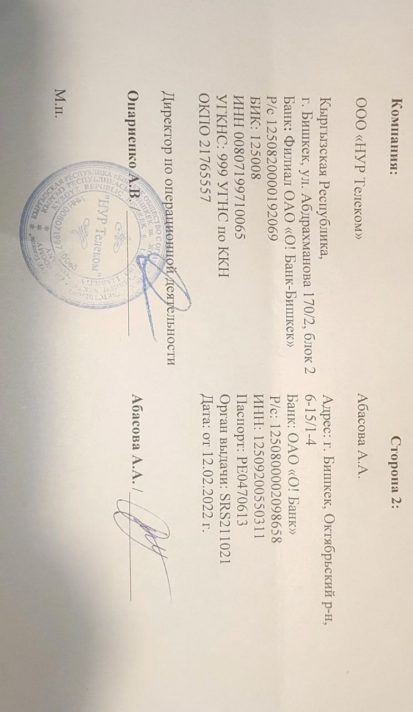

# InformationSecutriy
In this repository all labs of Information Security class fall 2026 are going to be stored
# Information Security Course (COM-424.1)

This repository contains completed laboratory works for the Information Security course at AUCA, Fall 2026.

- Instructor: Gulzada Esenalieva
- Student: Alina Abasova

## Labs

| Lab | Topic |
|-----|-------|
| [lab1](./lab01) | UNIX commands |
| [lab2](./lab02) | User management in Linux |
| [lab3](./lab03) | Permissions in Linux |
| [lab4](./lab04) | Nginx configuration |
| [lab5](./lab05) | Vim editor |
| [lab6](./lab06) | Crontab |
| [lab7](./lab07) | Package management |
| [lab8](./lab08) | Installing packages from source |
| [lab9](./lab09) | Cyber threats |
| [lab10](./lab10) | Caesar cipher |
| [lab11](./lab11) | Network connections |
| [lab12](./lab12) | Password management |
| [lab13](./lab13) | Phishing detection |

## Attendance

Because of my internship, I was allowed to attend 1 of 2 weekly classes. Proof:

## Academic Honesty & Ownership

These are my own laboratory works for coursework. Do not copy for submissions where that would violate the institution's policy.

---

**Acknowledgement:** I acknowledge that I have familiarized myself with the syllabus and vow to submit all tasks on time and accept disciplinary punishment for failing to do so.