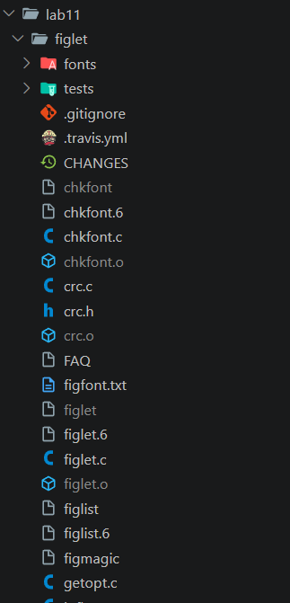

# Lab 11: Installing Packages from Source

Utility: figlet (prints text as ASCII art)

Method: git clone + make + make install

## Steps
1. Cloned the source code: `git clone https://github.com/cmatsuoka/figlet.git`
2. Went into the folder: `cd figlet`
3. Built from source: `make`
4. Installed: `sudo make install`
5. Verified the install path: `which figlet` -> `/usr/local/bin/figlet`
6. Ran the installed utility: `figlet "Lab 11 OK"`

## Result
The build finished without errors. `make install` copied the binaries to `/usr/local/bin`, the man pages to `/usr/local/man/man6` and the fonts to `/usr/local/share/figlet`.

Screenshot of the installation and the result:

The full terminal output is in [terminal.txt](./terminal.txt).